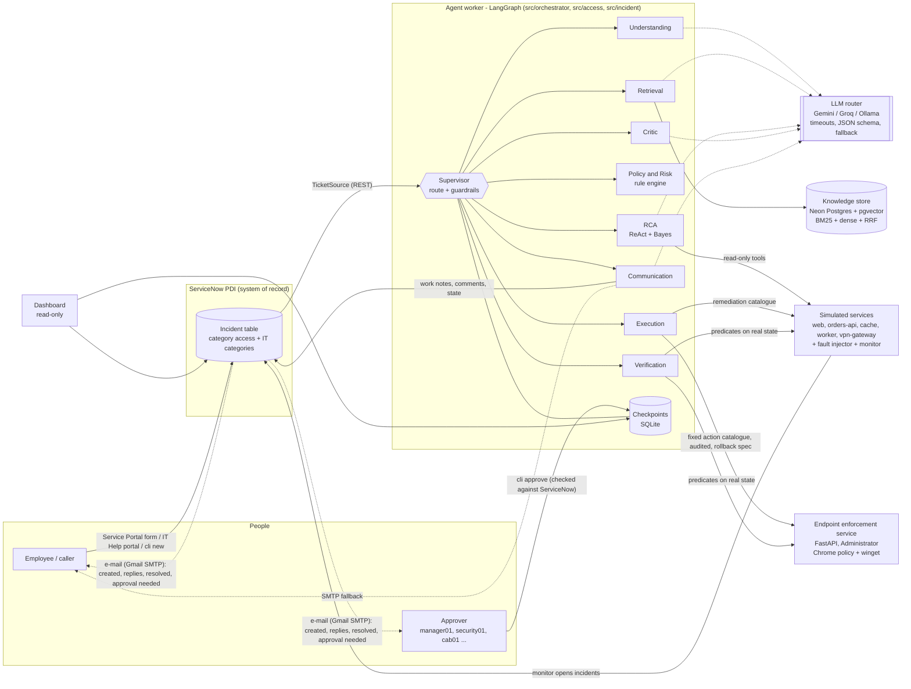

# A Multi-Agent Framework for Intelligent Enterprise IT Incident Management, Root Cause Analysis, and Policy-Aware Automated Resolution

B.E. (CSE) major project, Chaitanya Bharathi Institute of Technology (CBIT), Hyderabad.
Authors: **Karre Sai Karthik**, **Kasam Revan Sai Karthikeya** · Supervisor: **Dr. I. Srujana**

A LangGraph multi-agent system that works on real ServiceNow tickets. Each agent has its own role, its own tools
and its own LLM. LLMs only extract, retrieve, review and explain; **every decision that changes something is made
by deterministic, auditable code**:

1. **Synthetic ITSM datasets.** 1500 historical tickets, 60 SOPs and 60 policies, generated with
   Mistral-7B-Instruct and validated deterministically (`data/raw/`, notebook `data/raw/data_gen.ipynb`).
2. **Policy-aware access requests on a restricted Windows endpoint.** An employee asks for a website, an AI tool
   or software. The agents decide ALLOW / DENY / ALLOW_WITH_APPROVAL / ESCALATE_FOR_REVIEW, enforce the decision
   on the laptop through a fixed action catalogue, verify the real endpoint state, and record everything on the
   ServiceNow incident. A human is involved only when a policy requires an approval.
3. **Incident resolution on simulated services.** Monitoring opens an incident when one of five local services
   breaks: a web shop, its API, a cache, a queue worker, and a remote-access **VPN gateway** (IPsec tunnel,
   internal DNS, VPN profiles). An employee can also report a problem in their own words ("I cannot connect to
   the VPN"). A ReAct RCA agent with Bayesian root-cause ranking finds the cause. A remediation is chosen from the
   SOPs and passes a policy check, a critic and, if required, an approval. It is executed, the fix is verified
   by predicates, and it is rolled back or escalated if the fix does not hold.

Employees raise tickets themselves, either in the **ServiceNow Service Portal** (form "AI Service Desk request",
with their own login) or in the local **IT Help** portal on their Windows desktop. They follow the agents' replies
there and **by e-mail**: ServiceNow notifications sent through a Gmail account, with the agents' own SMTP as a
fallback. Approvers are e-mailed when a request waits for them.

---------------------------------------------------------------------------------------------------------------

## Architecture



**Access flow:** supervisor -> Understanding (LLM extraction, grounded in the text) -> Retrieval (LLM query
rewrite + hybrid search) -> Policy and Risk (rules) -> Critic (a different LLM plus deterministic checks; it can
only block or escalate) -> approval interrupt if needed -> Execution -> Verification (max 2 attempts, then
ESCALATE) -> Communication.

**Incident flow:** supervisor -> triage -> retrieval -> RCA (ReAct tool loop, then Bayesian ranking) -> SOP plan
plus the policy of that SOP (rules) -> critic -> approval if needed -> remediation -> predicate verification ->
next plan or rollback -> escalate.

### Design rules (never broken)
- The final policy decision is rule-based (ESCALATE if the target is unknown; DENY if prohibited or the role is
  not eligible; ALLOW_WITH_APPROVAL if approval is required or the risk is HIGH or above; otherwise ALLOW).
- Every LLM call has a timeout, JSON-schema validation, a fallback chain and a log line, plus a rule-based fallback
  that works without any API key (`--rules-only`).
- Endpoint and lab changes happen only through fixed action catalogues. Each action is audit-logged with
  action_id, ticket_id, authorization_id and a rollback spec.
- Nothing is reported RESOLVED without a passing verification predicate on the real state.
- Agents never call ServiceNow directly; they go through the `TicketSource` interface (ServiceNow or a local
  SQLite desk).
- Approvals are given with the CLI. The approver is checked against ServiceNow: the line manager or a member of
  the right group, and never the requester.

---------------------------------------------------------------------------------------------------------------

## Repository layout

| Path | What |
|---|---|
| `data/raw/` | datasets, data dictionary, validation report, generation notebook |
| `src/knowledge/` | `prepare` (texts + 80/20 stratified split), BM25, embeddings (bge-small-en-v1.5), pgvector schema, `ingest`, `retriever` (BM25 / dense / RRF hybrid), `eval_retrieval` |
| `src/common/` | config, `llm_router` (per-agent models, fallback chain, cooldowns, warm-up), `llm_stats`, `check_llms`, `check_db` |
| `src/orchestrator/` | LangGraph state, supervisor graph + `route()`, guardrails, trace, SQLite checkpointer |
| `src/access/` | access agents, critic, communication, catalogue (30 targets / 11 policies), ticket sources, worker, CLI |
| `src/incident/` | incident agents, RCA (ReAct), Bayesian ranking, evidence features, read-only tools |
| `src/lab/` | simulated services incl. the VPN gateway, supervisor, fault injector (11 faults), remediation actions, monitor |
| `src/portal/` | local "IT Help" portal for employees (token sign-in from a desktop shortcut) |
| `src/common/notify.py` | e-mail: SMTP fallback for messages ServiceNow did not send |
| `src/integrations/` | ServiceNow REST client, auth check, integration-user creation, idempotent setup |
| `src/dashboard/` | read-only web dashboard |
| `endpoint_service/` | Windows enforcement service (Chrome policies for `employee01`, winget installs), scripts |
| `evaluation/` | `eval_access`, `eval_incident`, `ablations`, labelled requests, `results/` |
| `scripts/` | demos, demo reset, pre-commit secret scan |
| `tests/` | offline unit tests (stdlib `unittest`, fake LLMs, fake endpoint, fake lab) |

---------------------------------------------------------------------------------------------------------------

## Setup (Windows 10/11)

Requirements: Python 3.12, Git, about 3 GB of disk space (Python packages and the embedding model), internet
access. Accounts: Neon (free), a ServiceNow Personal Developer Instance (free), a Google AI Studio key (free) and a
Groq key (free). Ollama and a Hugging Face token are optional. Without any LLM key everything still runs with
`--rules-only`.

### 1. Clone and install
```powershell
git clone https://github.com/karthikeya12082005/itsm-agentic-framework.git
cd itsm-agentic-framework
python -m venv .venv
.\.venv\Scripts\Activate.ps1
pip install -r requirements.txt
```

### 2. Configure `.env`
```powershell
Copy-Item .env.example .env
notepad .env          # put every value between single quotes: NAME='value'
```
| Variable | Value |
|---|---|
| `DATABASE_URL` | Neon: console.neon.tech -> project -> Connect -> connection string (`sslmode=require`) |
| `ENDPOINT_URL` | `'http://127.0.0.1:8765'` |
| `ENDPOINT_TOKEN` | any random 40 characters: ``-join ((48..57)+(65..90)+(97..122) \| Get-Random -Count 40 \| % {[char]$_})`` |
| `SERVICENOW_INSTANCE` | `'https://devXXXXXX.service-now.com'` (developer.servicenow.com -> My Instance) |
| `SERVICENOW_USER` / `SERVICENOW_PASSWORD` | `'ai.agent'` and its password (step 4) |
| `SERVICENOW_ADMIN_PASSWORD` | only while running the setup scripts in step 4; empty afterwards |
| `GEMINI_API_KEY`, `GEMINI_MODEL_LITE` | aistudio.google.com -> Get API key; `'gemini-3.5-flash-lite'` |
| `GROQ_API_KEY` | console.groq.com -> API Keys |
| `OLLAMA_BASE_URL` | `'http://localhost:11434'` (optional) |
| `HF_TOKEN` | huggingface.co -> Settings -> Access Tokens -> Read (optional) |
| `LLM_UNDERSTANDING` ... `LLM_COMMUNICATION` | `provider:model` per agent, e.g. `'groq:openai/gpt-oss-20b'`; see `python -m src.common.check_llms --list` |
| `NOTIFY_DEMO_EMAIL` | one mailbox for all demo people (they get plus-addresses such as `you+employee01@gmail.com`) |
| `SMTP_HOST`, `SMTP_PORT`, `SMTP_USER`, `SMTP_PASSWORD` | `smtp.gmail.com`, `587`, the Gmail address, a Gmail **App Password** (needs 2-Step Verification) |

`.env` is git-ignored. Run `python scripts/check_staged_secrets.py` before every commit.

### 3. Knowledge store (Neon + pgvector)
```powershell
python -m src.common.check_db          # connection + pgvector
python -m src.knowledge.prepare        # data/raw -> data/processed (texts + train/test split)
python -m src.knowledge.ingest         # schema + embeddings -> Neon (re-runnable)
```
`data/processed` is git-ignored, but the agents load it at import time, so `prepare` is required.

### 4. ServiceNow PDI (one time)
1. Wake the instance on developer.servicenow.com and put the admin password into `SERVICENOW_ADMIN_PASSWORD`.
2. `python -m src.integrations.create_ai_agent`: creates the integration user `ai.agent` with its roles and
   prints a link. Open it, click **Set Password -> Generate**, copy the password into `SERVICENOW_PASSWORD`, then
   click **Save Password**.
3. `python -m src.integrations.servicenow_setup`: creates the user records (employee01, manager01 and the
   approvers) and the groups (IT Security, AI Service Desk, Change Advisory Board, ...). It is idempotent.
4. `python -m src.integrations.servicenow_portal_setup`: creates the portal form "AI Service Desk request", the
   "approval needed" notification, and ServiceNow's outgoing mail account (Gmail SMTP from `.env`). It switches
   outbound e-mail on and gives the demo people their plus-addresses. Run `--check` first to see what it would
   change, and `--test` afterwards (it submits the form as employee01).
5. Logins: in the PDI as admin, open **User Administration → Users** and, for each of employee01, manager01,
   security01, serviceowner01, cab01, aigov01, appowner01 and dataowner01, click **Set Password**, then
   **Save Password**. API password writes have no effect on PDIs.
6. Clear `SERVICENOW_ADMIN_PASSWORD` again, then check:
   `python -m src.integrations.check_sn_auth` (HTTP 200) and `python -m src.integrations.servicenow_setup --test`.

### 5. LLMs
```powershell
python -m src.common.check_llms --list      # live model ids per provider
python -m src.common.check_llms --agents    # each agent's chain answers through the router
```

### 6. Restricted endpoint (Objective 2 on a real laptop; Administrator terminal)
```powershell
powershell -ExecutionPolicy Bypass -File .\endpoint_service\scripts\create_employee01.ps1
# sign in once as employee01 (creates its profile), sign out again, then:
powershell -ExecutionPolicy Bypass -File .\endpoint_service\scripts\apply_employee_policies.ps1
python -m uvicorn endpoint_service.server:app --host 127.0.0.1 --port 8765     # keep this terminal open
```
Check it from a normal terminal with `python endpoint_service\test_endpoint.py`. Chrome must be restarted for
`employee01` to pick up new policies.

### 7. IT Help portal for employee01 (Administrator terminal, once)
```powershell
powershell -ExecutionPolicy Bypass -File .\scripts\portal\install_it_help.ps1 -UserName employee01
```
This writes a sign-in token into employee01's own profile, readable only by that user and administrators, and puts
an **IT Help** shortcut on their desktop. The portal itself runs in the project owner's normal terminal
(`python -m src.portal`); employee01 never needs the project folder or `.env`.

---------------------------------------------------------------------------------------------------------------

## Demonstration: every service, step by step

This walkthrough shows all parts working together on one Windows laptop: access requests enforced on the
endpoint, problem reports diagnosed on the simulated services, monitoring, approvals, both portals, e-mail and
the dashboard. It assumes the setup above is complete. Ticket numbers (`INC00100xx`) are examples; use the ones
you see.

**Accounts used:** Windows `Karthikeya` (project owner, runs the services) and Windows `employee01` (restricted
employee). In ServiceNow: employee01, plus the approvers security01 (IT Security), serviceowner01 (IT service
owner) and cab01 (Change Advisory Board). Their e-mails all arrive in the one demo inbox (`NOTIFY_DEMO_EMAIL`).

### Step 0 - Start the services (as Karthikeya)
Open four terminals in the project folder. In every **normal** terminal, run `.\.venv\Scripts\Activate.ps1`
first.

| Terminal | Command | Keep it open? |
|---|---|---|
| T1 **Administrator** PowerShell | `python -m uvicorn endpoint_service.server:app --host 127.0.0.1 --port 8765` | yes (enforces access on the laptop) |
| T2 normal | `python -m src.lab.supervisor reset` | no; the five lab services keep running in the background |
| T3 normal | `python -m src.access.cli worker` | yes (the agents: polls ServiceNow every 30 s) |
| T4 normal | `python -m src.portal` | yes (IT Help portal on 127.0.0.1:8810) |

Optionally, a fifth normal terminal for `python -m src.dashboard` gives the read-only dashboard at
http://127.0.0.1:8800.

Check that everything is up (any normal terminal):
```powershell
python -m src.integrations.check_sn_auth            # ServiceNow: HTTP 200 (wake the PDI first if it hibernates)
python -m src.access.endpoint_client status         # endpoint: allowlist [], 18 blocked domains
python -m src.lab.supervisor status                 # web, orders-api, cache, worker, vpn-gateway: ok
python -m src.common.check_llms --agents            # every agent's model chain answers (rules still work without)
```

### Step 1 - The employee asks for access (IT Help portal, as employee01)
1. **Switch user** to employee01: Start → your account picture → employee01. Do **not** sign out of Karthikeya;
   the services keep running there.
2. Double-click **IT Help** on employee01's desktop. Chrome opens "IT Help - signed in as employee01".
3. Send these requests one by one. Choose **"Access to a website, AI tool or software"** for all of them:

| Type this | What the agents do | Final state |
|---|---|---|
| `I need access to gemini.google.com to draft documentation` | POL-0028 ALLOW → allowlist → verify | Resolved (about 15 s) |
| `I need ChatGPT to debug my Python code` | POL-0030 DENY, suggests Gemini | Closed / rejected |
| `I need access to github.com to clone our dependencies` | POL-0025 needs IT Security approval | Awaiting approval |
| `Please give me access to notion.so for team notes` | not in the catalogue | Escalated to the Service Desk |
| `Please install 7-Zip for 2 minutes` | POL-0023 ALLOW, time-limited install (winget, about 1 min) | Resolved, uninstalled automatically after 2 minutes |

4. The page refreshes by itself. Click a ticket to see the agents' replies.
5. **Restart Chrome** (close every window), then open gemini.google.com: it works now. chatgpt.com stays blocked.
6. The demo inbox receives, for employee01, "Incident … was created", "Comment added to …" and "… was resolved".
   It also receives **"Approval needed: INC…"** for security01. The first mails may land in Spam.

### Step 2 - An approver decides (as Karthikeya, any normal terminal)
The approval mail for the GitHub ticket names who may approve. Approvals are given with the CLI, and the
approver is checked against ServiceNow:
```powershell
python -m src.access.cli approve INC00100xx --by manager01     # REFUSED: not in IT Security (exit code 2)
python -m src.access.cli approve INC00100xx --by security01    # ACCEPTED -> allowlist -> verified -> Resolved
```
As employee01, restart Chrome: github.com now opens. Add `--reject` to the second command to see a rejection.

### Step 3 - The employee uses the ServiceNow portal (real login)
1. In Chrome (an Incognito window is easiest), open
   `https://<instance>/sp?id=sc_cat_item&sys_id=<form sys_id>`. The setup script prints this link; on dev219979 it
   is `https://dev219979.service-now.com/sp?id=sc_cat_item&sys_id=aceaf74dc3f49390a471df0d0501310f`.
2. Sign in as **employee01** with the password set in step 4.5 of the setup.
3. Choose **"Access to a website, AI tool or software"**, type `I need access to stackoverflow.com for coding
   questions`, and submit. Like GitHub, it waits for IT Security approval (POL-0026); approve it as in Step 2.
4. Open **My Requests** in the portal menu. All of employee01's tickets are listed, including the ones from IT
   Help. Open one to read the agents' replies. Other people's tickets are not visible.

### Step 4 - The employee reports a VPN problem (live diagnosis)
1. As Karthikeya (T2), break the VPN tunnel: `python -m src.lab.faults inject vpn_tunnel_down`.
2. As employee01, in IT Help choose **"Problem: VPN or network"** and type
   `I cannot connect to the VPN from home, the shop does not open`.
3. Within a minute the ticket is **Resolved**, and the reply says the tunnel was restarted. Behind it:
   - triage found `vpn-gateway`
   - the ReAct RCA agent called `check_vpn` and the Bayesian ranking put NETWORK_FAILURE first
   - POL-0004 allowed the fix for the employee's role
   - the tunnel was restarted and the fix verified
4. Check: `python -m src.lab.supervisor status` shows vpn-gateway `ok`, and
   `python -m src.access.cli trace INC00100xx` shows every agent step with its model and latency.

### Step 5 - Monitoring finds outages by itself (as Karthikeya)
```powershell
python -m src.lab.faults inject dns_failure          # stale DNS record on the gateway
python -m src.lab.monitor --once                     # opens a ServiceNow incident (category network)
```
The worker picks it up. The fix (UPDATE_DNS_RECORD, POL-0001) needs the IT service owner, so the incident waits,
and "Approval needed" goes to serviceowner01:
```powershell
python -m src.access.cli approve INC00100xx --by serviceowner01
```
More faults to try (run `python -m src.lab.supervisor reset` between them):

| Fault | Expected outcome |
|---|---|
| `vpn_credential_expired` | VPN profile re-issued, Resolved |
| `memory_leak`, `disk_full` | fixed automatically |
| `bad_config` | rollback needs the Change Advisory Board: `approve INC… --by cab01` |
| `vpn_tunnel_down` raised **by monitoring** | Escalated: POL-0004 does not allow the monitoring on-call role to restart the device (Step 4 shows the employee path) |

`python -m src.lab.faults list` lists all 11 faults. The monitor can also run continuously:
`python -m src.lab.monitor --interval 15`.

### Step 6 - Watch and explain
- Dashboard (`python -m src.dashboard`, http://127.0.0.1:8800):
  - tickets, with each ticket's route, agent trace, policy, critic, RCA ranking and work notes
  - the evaluation tables
  - LLM latency and fallbacks
- `python -m src.access.cli show INC00100xx` prints the ticket and its work notes.
- In ServiceNow, open the incident: every agent step is a work note, every message to the employee is a comment,
  and the approval field and state are set.

### Step 7 - Reset after the demo (as Karthikeya)
```powershell
powershell -ExecutionPolicy Bypass -File scripts\reset_demo.ps1                     # dry run: what would be undone
powershell -ExecutionPolicy Bypass -File scripts\reset_demo.ps1 -Apply -CancelOpen  # roll back grants, cancel open tickets
python -m src.lab.supervisor stop
```
Then stop T1, T3 and T4 with Ctrl+C. Time-limited grants (like the 7-Zip install) are also undone by the
worker's expiry sweep.

### Short versions
- `powershell -ExecutionPolicy Bypass -File scripts\demo_access.ps1 -AutoApprove`: five access requests end to
  end, with the approval.
- `powershell -ExecutionPolicy Bypass -File scripts\demo_incident.ps1 -Fault dns_failure -AutoApprove`: one
  monitored fault end to end.

---------------------------------------------------------------------------------------------------------------

## Command reference

### One-command demos (normal terminal)
```powershell
powershell -ExecutionPolicy Bypass -File scripts\demo_access.ps1 -AutoApprove       # 5 access requests, end to end
powershell -ExecutionPolicy Bypass -File scripts\demo_incident.ps1 -Fault bad_config -AutoApprove
powershell -ExecutionPolicy Bypass -File scripts\reset_demo.ps1                     # dry run: what would be undone
powershell -ExecutionPolicy Bypass -File scripts\reset_demo.ps1 -Apply -CancelOpen  # undo grants, cancel open tickets
```
Add `-Local` to use the offline SQLite desk instead of ServiceNow and `-RulesOnly` to run without LLMs. Without
`-AutoApprove`, the demo prints the `approve` command for you to run. The reset rolls back only grants that are
still live on the endpoint (domain still allowlisted, package still installed), newest first, through the
enforcement service. It reads the service's audit log, so run it from the same checkout as the endpoint service.
Only one checkout's lab can run at a time, because the lab services use fixed ports 9101-9104.

### Access requests by hand
```powershell
python -m src.access.cli new "Please give me access to github.com to clone dependencies"
python -m src.access.cli worker               # polls ServiceNow (Ctrl+C to stop); --once = one pass
python -m src.access.cli approve INC0010060 --by security01      # or --reject; the wrong person is refused
python -m src.access.cli show INC0010060      # ticket + work notes
python -m src.access.cli trace INC0010060     # agent trace: model, latency, fallback per step
python -m src.access.cli list | grants | sweep
```
Options: `--source local`, `--rules-only`, `--llm-single groq:openai/gpt-oss-20b`, `--no-retrieval`,
`--no-rewrite`, `-v` (log every LLM call).

### How employees raise tickets
Two ways in, plus e-mail, and the same agent worker handles them all:
1. **ServiceNow Service Portal.** Sign in as the employee and open the "AI Service Desk request" form at
   `https://<instance>/sp?id=sc_cat_item&sys_id=<form sys_id printed by servicenow_portal_setup>`. Choose "Access
   to a website, AI tool or software" or a problem type (VPN/network, application, software, hardware) and
   describe it. **My Requests** shows the tickets and the agents' replies.
2. **IT Help on the Windows desktop.** Double-click the shortcut, use the same form, and see your tickets with
   the replies. It needs `python -m src.portal` running.
3. **E-mail.** ServiceNow mails the employee when the ticket is created, when the agents reply, and when it is
   resolved. Approvers get "Approval needed: INC…" with the `approve` command. If ServiceNow has not sent a mail
   after 3 minutes, the worker sends it by SMTP (`python -m src.access.cli notify` sends pending mails on demand).

From the command line: `python -m src.access.cli new --category network "I cannot connect to the VPN"`. Access
requests use the employee's role in the policy check; problem reports are diagnosed on the lab services.

### Incidents on the simulated services
```powershell
python -m src.lab.supervisor start            # web 9101, orders-api 9102, cache 9103, worker 9104, vpn-gateway 9105 (no admin, no Docker)
python -m src.lab.faults list
python -m src.lab.faults inject memory_leak
python -m src.lab.monitor --once              # opens a ServiceNow incident for each independent failure
python -m src.access.cli worker --once        # the same worker handles incidents
python -m src.lab.supervisor reset            # healthy again
```
Network faults: `vpn_tunnel_down` (fix: restart the network device), `dns_failure` (flush the resolver and re-sync
the record; needs IT service owner approval), `vpn_credential_expired` (re-issue the VPN profile). The policy is
checked with the role of whoever raised the ticket. POL-0004 lets an employee's VPN outage be fixed by an
automatic tunnel restart, but not one raised by the monitoring on-call role; that one is escalated to the
Service Desk.

### Dashboard
```powershell
python -m src.dashboard                       # http://127.0.0.1:8800  (--source local for the offline desk)
```
It shows the system status (ServiceNow, endpoint service, lab), the tickets, each ticket's route, agent trace,
policy, critic, RCA ranking, remediation and work notes, the evaluation tables, and per-model LLM latency and
fallbacks. The dashboard is read-only.

### Tests and evaluation
```powershell
python -m unittest discover -s tests -t .                  # offline: fake LLMs, fake endpoint, fake lab
python -m src.knowledge.eval_retrieval [--category]        # BM25 vs dense vs hybrid on 301 test tickets
python -m evaluation.eval_access                           # Objective 2 (dataset + 52 labelled requests)
python -m evaluation.eval_incident                         # Objective 3 (8 faults x reps + 194 dataset incidents)
python -m evaluation.ablations --part access incident rewrite latency
```
Results are written to `evaluation/results/*.md|json|csv`. Free-tier LLM rate limits apply, so the evaluations
pace their calls (`--pace`) and report how many LLM calls were answered and how many fell back.

---------------------------------------------------------------------------------------------------------------

## Results (Nov 2026; details in `evaluation/results/`)

**Retrieval** (301 held-out tickets, category filter): hybrid BM25 + dense + RRF reaches SOP Hit@1 0.887,
Hit@3 0.980; policy Hit@1 0.857, Hit@3 0.980; similar-incident P@5 0.980.

**Access requests** (52 labelled requests, full graph, simulated endpoint):

| | rules-only | multi-LLM agentic |
|---|---|---|
| Decision exact match | 0.981 | 0.981 |
| Automation rate | 0.846 | 0.827 |
| Escalation rate | 0.135 | 0.154 |
| Verification pass rate | 1.0 | 1.0 |
| MTTR (batch) | 0.43 s | 4.35 s |

On the dataset's 77 access tickets, the rule engine matches the label in 0.844 of cases, and in 1.000 when the 12
labels that cannot be derived from policy and role are excluded.

**Incident resolution** (11 injected faults incl. the 3 VPN/network faults, x 2 repetitions, Phase 6 run):

| | rules-only | multi-LLM agentic |
|---|---|---|
| Root-service accuracy | 1.0 | 1.0 |
| RCA top-1 / top-3 | 1.0 / 1.0 | 1.0 / 1.0 |
| Correct remediation action | 1.0 | 1.0 |
| Correct final outcome | 1.0 | 1.0 |
| Resolution rate | 0.909 | 0.909 |
| MTTR mean (injection -> verified) | 20.6 s | 23.0 s |

The two unresolved runs per mode are the monitoring-raised tunnel outages. They are escalated on purpose: POL-0004
does not allow the monitoring on-call role to restart the device. In the agentic run, 48 % of the LLM calls were
answered by a model; the rest fell back to rules because of free-tier quotas. The earlier 8-fault run without the
VPN service gave a top-1 of 1.0 / 0.938 (rules / agentic).

On 194 held-out dataset incidents, top-1 / top-3 root-cause accuracy from creation-time text is 0.196 / 0.521
with the prior alone and 0.268 / 0.588 with naive Bayes. Adding the LLM hypothesis gives 0.283 / 0.633
(measured on 60 incidents).

**Ablations** (`evaluation/results/ablations_summary.md`):
- **Rules vs agentic, single vs multi-LLM:** policy decisions and final states are the same in every variant,
  because the rule engine decides.
  - Access: final-state match 0.981 in every variant; decision match 0.962 with single qwen.
  - Incidents: all 8 faults resolved with rules, multi-LLM, and single qwen3.8-27b.
  - With single gpt-oss-20b, one fault (memory leak) was escalated: the small model's hypothesis lowered the
    posterior to 0.458, below the 0.5 confidence gate, so the system escalated instead of acting.
- **What the LLMs add:**
  - Grounded extraction of free text.
  - A stricter critic: one more access request is escalated (automation 0.827 vs 0.846).
  - Better retrieval queries: the query rewrite raises SOP Hit@1 from 0.438 to 0.604 and policy Hit@1 from 0.312
    to 0.417 on free-text requests.
  - Readable messages to the user.
- **Cost:** about 3–4 s per access ticket, compared with 0.4 s for rules only.
- **Median latency per answered call:**

  | Model | Median latency | Called attempts answered |
  |---|---|---|
  | Groq qwen3.8-27b | 0.77 s | 0.997 |
  | Groq gpt-oss-20b | 0.92 s | 0.984 |
  | Groq gpt-oss-120b | 0.99 s | 0.852 |
  | Gemini 3.5-flash-lite | 1.46 s | 0.896 |
  | Gemini 3.5-flash | 2.01 s | 0.479 (free-tier quota) |
  | Ollama llama3.2:3b (local) | 4.14 s | - |

## Known limitations
- Free-tier LLMs (Gemini 429/503, Groq tokens per minute) often fall back to the secondary model or to rules. The
  router logs every fallback, and decisions stay correct because they never depend on an LLM.
- VS Code cannot be installed while it is running. The agents detect this and ask the user to close it.
- The synthetic dataset's root-cause labels are only weakly tied to the ticket text, so the dataset RCA numbers
  are low in absolute terms; the injected-fault lab is the main RCA benchmark.
- Access requests are incidents with category `access`; a Service Catalog front end is future work.
